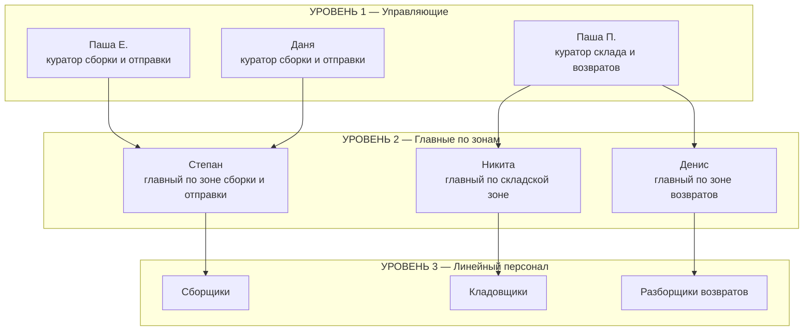

# 1. Структура склада и иерархия

> Версия 1.0 · Утверждено управляющими: ⬜ Паша П. ⬜ Паша Е. ⬜ Даня · Дата: «___» ________ 2026 г.

## 1.1. Зоны склада

Весь склад разделён на три зоны. Каждый квадратный метр склада и каждый процесс закреплён ровно за одной зоной — «ничьих» участков и «ничьих» задач не существует.

| Зона | Что в неё входит | Главный по зоне | Курирующий управляющий |
|---|---|---|---|
| **Зона сборки и отправки** | Сборка заказов, проверка, упаковка, маркировка, стеллажи готовых заказов, передача перевозчику / отгрузка | **Степан** | **Паша Е. и Даня** |
| **Складская зона (зона хранения)** | Приёмка поставок, размещение по ячейкам, хранение, пополнение зоны отбора, инвентаризация, остатки | **Никита** | **Паша П.** |
| **Зона возвратов** | Приёмка возвратов, разбор и оценка состояния, возврат товара в сток, зона брака, акты и претензии | **Денис** | **Паша П.** |

> ⚠️ **Допущение к проверке:** в исходной постановке было противоречие, кто из управляющих какое направление курирует. Здесь принято: **Паша П. — склад и возвраты; Паша Е. и Даня — сборка и отправка.** Если наоборот — поменять имена в этой таблице и в разделе 2, больше нигде имена управляющих не привязаны к зонам.

## 1.2. Иерархия: три уровня управления

| Уровень | Кто | За что отвечает | Горизонт решений |
|---|---|---|---|
| 1. Управляющие | Паша П., Паша Е., Даня | Бизнес в целом: деньги, стратегия, найм/увольнение, KPI, процессы, отношения с маркетплейсами/перевозчиками/поставщиками | Недели, месяцы |
| 2. Главные по зонам | Степан, Никита, Денис | Ежедневная работа своей зоны: люди, качество, скорость, порядок, отчётность | Сегодня, эта неделя |
| 3. Линейный персонал | Сборщики, кладовщики, разборщики возвратов | Качественное выполнение своих операций по СОП | Текущая задача, смена |

## 1.3. Пять принципов управления

1. **Единоначалие.** У каждого сотрудника ровно один непосредственный руководитель — главный его зоны. Задачи, выходные, обучение, замечания — всё идёт через него. Управляющие ставят задачи **главным по зонам**, а не линейным сотрудникам напрямую (исключение — ЧП и угроза безопасности: тогда любой руководитель вправе дать прямое указание, а главный зоны уведомляется сразу после).
2. **Зона = ответственность.** Всё, что происходит в зоне, — ответственность её главного: и результат, и ошибки, и порядок, и люди. «Это сделал не я, а мой сотрудник» — не аргумент.
3. **Стыки фиксируются.** Любая передача товара между зонами (склад → сборка, возвраты → склад и т.д.) фиксируется: что, сколько, кто передал, кто принял, когда. Устные передачи «на доверии» запрещены — именно на стыках теряется товар и рождаются конфликты.
4. **Эскалация вверх, а не вбок.** Проблему между зонами решают между собой главные по зонам. Не договорились за 1 день — вопрос поднимается курирующим управляющим. Линейные сотрудники не выясняют отношения с чужой зоной — передают вопрос своему главному.
5. **Одна версия правды.** Как правильно работать — написано в этом регламенте. Устное указание, противоречащее регламенту, не отменяет регламент: либо документ обновляется (решением управляющих), либо работаем как написано.

## 1.4. Правило двух кураторов зоны сборки

У Степана два курирующих управляющих — Паша Е. и Даня. Чтобы это не превращалось в «двух начальников с разными указаниями»:

- Указания обоих равнозначны и обязательны.
- Если указания противоречат друг другу, Степан **не выбирает сам**, а сообщает обоим о противоречии; Паша Е. и Даня согласуют позицию между собой и дают одно решение.
- Рекомендуется письменно разделить сферы между кураторами (например: Даня — операционка, графики, персонал; Паша Е. — процессы, маркетплейсы, отгрузки) и вписать сюда: `[заполнить после решения]`.

## 1.5. Замещение при отсутствии

| Кто отсутствует | Кто замещает | Примечание |
|---|---|---|
| Главный по зоне (отпуск, болезнь, выходной) | Назначенный им **старший сотрудник зоны**, при его отсутствии — курирующий управляющий | Каждый главный обязан в течение 3 месяцев подготовить себе заместителя из команды и назвать его управляющим |
| Управляющий | Другой управляющий (по договорённости между ними) | Главные по зонам должны знать, к кому идти |
| Линейный сотрудник | Главный зоны перераспределяет людей внутри зоны; при нехватке — запрашивает людей у соседней зоны через её главного | Переброска людей между зонами — только по договорённости главных |

Замещающий получает полномочия замещаемого на время отсутствия, кроме права нанимать и увольнять.

## 1.6. Кто может привлекать сотрудников чужой зоны

Потребность «одолжить» людей (пиковая отгрузка, большая поставка, завал по возвратам) — нормальная практика, но только по правилам:

1. Главный зоны-получателя просит людей у главного зоны-донора (не у сотрудников напрямую).
2. На время работы в чужой зоне сотрудник подчиняется главному той зоны, где работает.
3. Если главные не договорились, а потребность критичная, — решает курирующий управляющий.
4. Приоритет зон при конфликте ресурсов в обычный день: **отгрузка сегодняшнего дня → приёмка скоропортящихся/срочных поставок → возвраты → всё остальное.** Управляющие могут изменить приоритет на конкретный день.
